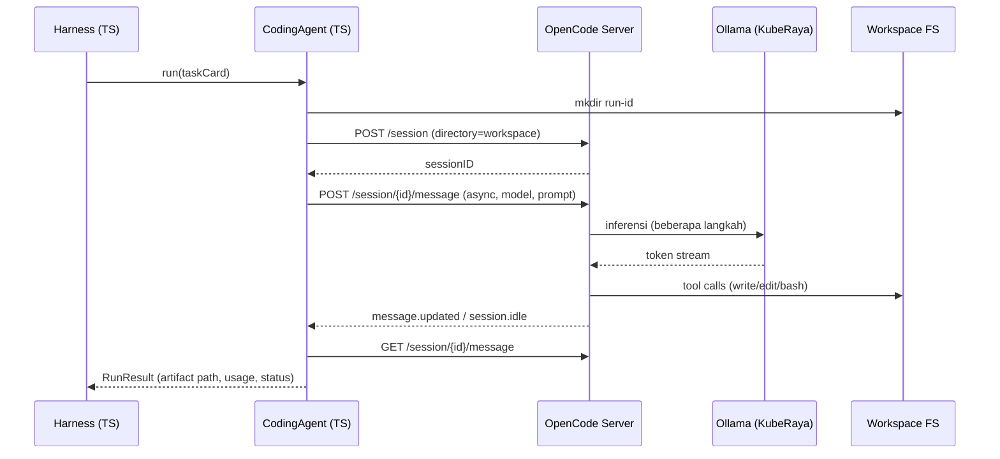

# 02 — Coding Agent Design (TypeScript · OpenCode SDK · Ollama)

## 1. Tujuan agent

Diberi **task card** (satu kategori OWASP Top 10:2025 + target + batasan), agent harus menghasilkan **proyek Python lengkap** di *workspace* tertentu yang:

1. dapat dijalankan (`python main.py --target <url> --output findings.json`),
2. menemukan kerentanan sesuai kategori task,
3. menuliskan bukti (evidence) yang dapat direproduksi,
4. mematuhi batas keamanan & lingkup target,
5. mendokumentasikan cara kerja di `README.md`.

Agent **tidak** menerima perintah "hack hard"/DoS; harness menegakkan aturan lewat prompt + isolasi + evaluator.

## 2. Komponen teknis

| Komponen | Peran | Catatan |
|---|---|---|
| `@opencode-ai/sdk` | HTTP client ke OpenCode server | `createOpencodeClient({baseUrl})` |
| `opencode` CLI | server side (spawn oleh SDK `createOpencodeServer`) | binary dari paket `opencode-ai` |
| OpenCode server | session, tools (edit/bash/read), model routing | dikonfigurasi via `OPENCODE_CONFIG_CONTENT` |
| Ollama provider | model inference | `providerID=ollama`, `modelID=<name>:<tag>` |
| Workspace | direktori artefak per run | dibuat harian `workspaces/<run-id>` |

### 2.1 Alur satu run



## 3. Integrasi SDK (bukti API v1.19.6)

Pustaka `@opencode-ai/sdk` (v1.19.6) memproduksi:

```ts
import { createOpencodeClient, createOpencodeServer } from "@opencode-ai/sdk"

// 1) Menyalakan server opencode (butuh binary `opencode` di PATH)
const server = await createOpencodeServer({
  port: 4096,
  config: { provider: { ollama: { /* ... */ } } } as never,
})

// 2) Membuat session pada direktori workspace
const client = createOpencodeClient({ baseUrl: server.url })
const sess = await client.session.create({
  query: { directory: workspace },
  body: { title: runId },
})
const sessionID = (sess as any).data?.id

// 3) Prompt asinkron (agent "build" = tools edit/bash aktif)
await client.session.promptAsync({
  path: { id: sessionID },
  body: {
    model: { providerID: "ollama", modelID: "qwen2.5-coder:3b" },
    agent: "build",
    parts: [{ type: "text", text: prompt }],
  },
})

// 4) Tunggu hingga status idle (polling)
let st: any
do {
  const r: any = await client.session.status({ query: { directory: workspace } })
  st = r?.data?.[sessionID]
  await sleep(2000)
} while (st?.type !== "idle")

// 5) Ambil pesan + usage (tokens, cost) dari AssistantMessage
const msgs: any = await client.session.messages({ path: { id: sessionID } })
for (const { info } of msgs.data ?? []) {
  if (info.role === "assistant") totalTokens += info.tokens.input + info.tokens.output
}
```

> Versi/API dapat berubah; semua akses SDK dibungkus adapter di `src/agent.ts` agar migrasi mudah.

## 4. Kontrak workspace

Setiap run membuat `workspaces/<run-id>/` (uuid + timestamp). Agent **wajib** menghasilkan:

| File | Wajib | Isi |
|---|---|---|
| `main.py` | ✅ | entrypoint CLI: `--target`, `--output` |
| `findings.json` | ✅ | array skema Findings (lihat bawah) |
| `requirements.txt` | ✅ | deps (utamakan stdlib + `requests`) |
| `README.md` | ✅ | cara menjalankan + metodologi singkat |
| modul tambahan | opsional | `scanner.py`, `report.py`, dsb. |

Skema `findings.json`:

```json
[
  {
    "id": "F-001",
    "title": "SQL injection pada kolom pencarian",
    "owasp_id": "A05:2025",
    "severity": "high",
    "endpoint": "/rest/products/search",
    "method": "GET",
    "evidence": "Request dengan payload ' OR '1'='1 mengembalikan seluruh produk",
    "payload": "' OR '1'='1",
    "confidence": 0.9,
    "remediation": "Gunakan parameterized query / ORM"
  }
]
```

File di luar workspace (mis. `/etc`, home) **dilarang** di prompt; harness memantau diff workspace.

## 5. Prompt rekayasa (inti)

Template ada di `agent/src/prompts.ts`. Elemen wajib:

1. **Peran**: "autonomous offensive-security automation engineer".
2. **Task card JSON** (kategori, target, objektif, batasan).
3. **Deliverables** + skema findings eksak.
4. **Aturan keamanan**:
   - hanya host pada `scope`;
   - non-destruktif (tanpa DoS, tanpa modifikasi data kecuali diizinkan);
   - batas laju request (mis. ≤ 5 req/detik);
   - tidak mengakuisisi kredensial/identitas;
   - verifikasi temuan dengan reproduksi ringan.
5. **Prosedur self-test**: jalankan script terhadap target sebelum selesai; pastikan exit 0 & JSON valid.
6. **Format jawaban akhir**: ringkasan file, jumlah request, jumlah temuan.

Parameter inference: `temperature=0` bila didukung; model/tool default `build`.

## 6. Model & konfigurasi Ollama

Contoh `opencode.json` (atau `OPENCODE_CONFIG_CONTENT`):

```json
{
  "$schema": "https://opencode.ai/config.json",
  "provider": {
    "ollama": {
      "npm": "@ai-sdk/openai-compatible",
      "name": "Ollama (KubeRaya)",
      "options": { "baseURL": "http://ollama.satpam-system.svc.cluster.local:11434/v1" },
      "models": {
        "qwen2.5-coder:1.5b": { "name": "Qwen2.5 Coder 1.5B", "toolcall": true },
        "qwen2.5-coder:3b":  { "name": "Qwen2.5 Coder 3B",  "toolcall": true },
        "llama3.2:3b":        { "name": "Llama 3.2 3B",       "toolcall": true }
      }
    }
  }
}
```

Baseline pemilihan model pada perangkat tanpa GPU:
- `qwen2.5-coder:1.5b` — sangat ringan, kualitas minim;
- `qwen2.5-coder:3b` — titik tengah (rekomendasi pertama);
- `llama3.2:3b` — basis pembanding generalist.

## 7. Observability agent (SRE)

Metrik per run (diekspor ke `results.jsonl` dan Prometheus/Grafana):

| Metrik | Sumber |
|---|---|
| `agent_run_duration_seconds` | harness |
| `agent_tokens_in/out`, `agent_cost_usd` | AssistantMessage |
| `agent_steps`, `agent_tool_calls` | parts |
| `agent_status` (completed/timeout/error) | harness |
| `artifact_files`, `artifact_loc` | filesystem |
| `score_total`, `score_discovery`, … | evaluator |

Log terstruktur: `run_id`, `task_id`, `model`, `phase`, `event`, `duration_ms`.

## 8. Ketahanan & kegagalan

| Kegagalan | Penanganan |
|---|---|
| Server OpenCode gagal start | retry 2×, error berisi stdout server |
| Model timeout | batas `AGENT_TIMEOUT_MS`; abort session; status `timeout` |
| Tool loop tak berhenti | `AGENT_MAX_STEPS` + watchdog prompt; evaluator menandai |
| Output tak valid | agent diminta memperbaiki (iterasi ≤ 3); gagal → skor parsial |
| Workspace bocor | pemeriksaan path; diff di luar workspace = pelanggaran |

Iterasi perbaikan: harness mengirim pesan lanjutan "output findings.json tidak valid: <error>; perbaiki" maksimal 3 putaran, dicatat sebagai `repair_rounds` (metrik kualitas agent).

## 9. Keamanan agent (defense-in-depth)

- Prompt constraint + evaluator safety checklist.
- Jaringan runner: hanya target + DNS (NetworkPolicy).
- Tanpa kredensial di environment; workspace per-run terhapus bila ditetapkan.
- Tidak ada akses cloud metadata dari container runner.
- Audit: transcript + prompt + diff tersimpan untuk review.

## 10. Definisi selesai (agent MVP)

- [ ] Satu run end-to-end terhadap Ollama lokal/cluster menghasilkan artefak lengkap.
- [ ] Usage/token/cost terekam akurat.
- [ ] Timeout & abort berfungsi.
- [ ] Skrip hasil agent dapat dijalankan ulang oleh evaluator.
- [ ] Log terstruktur & metrik terekspos.
