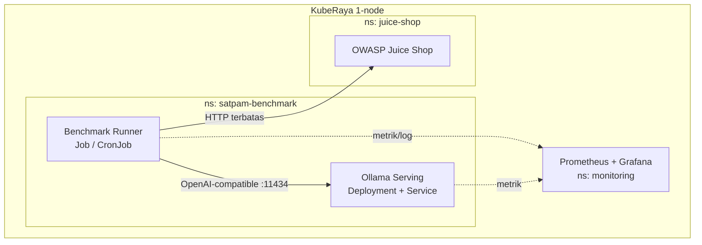

# 04 — Infra & SRE di KubeRaya

Dokumen ini menjelaskan lapisan infrastruktur portfolio: bagaimana **Ollama**, **target Juice Shop**, dan **benchmark runner** dioperasikan di Kubernetes 1-node (KubeRaya) dengan disiplin SRE (isolasi, observability, SLO, biaya, reprodusibilitas).

> Manifest statis: [`../manifests/60-benchmark/`](../manifests/60-benchmark/).
> Lapisan aplikasi lama (analyzer) diarsipkan di [`../archive/analyzer-v1/`](../archive/analyzer-v1/).

## 1. Tujuan

| Kebutuhan | Solusi |
|---|---|
| Inferensi model coding lokal | Ollama sebagai Deployment + Service dalam cluster |
| Target adversarial terisolasi | Juice Shop dalam namespace `juice-shop` |
| Runner benchmark reproducible | Job per model/rep, workspace `emptyDir` baru |
| Jaringan runner dibatasi | NetworkPolicy default-deny + allow target + DNS |
| Observability | Prometheus + Grafana, metrik `agent_*` |
| Biaya terkendali | ResourceQuota, LimitRange, token metering per run |

## 2. Topologi



## 3. Namespace & hardening

| Kontrol | Penerapan |
|---|---|
| Namespace | `satpam-benchmark` (runner + Ollama), `juice-shop` (target), `monitoring` |
| Pod Security Standards | `restricted` untuk workload benchmark; `baseline` untuk ingress |
| RBAC | ServiceAccount `benchmark-runner` dengan hak minimal (hanya Job/Job status) |
| ResourceQuota | `requests.cpu`/`limits.memory` per namespace |
| LimitRange | default request/limit agar pod tidak OOM di node tunggal |
| Secret | Model registry/token via Secret; **tidak** di-commit |

## 4. Komponen

### 4.1 Ollama serving

- `Deployment` image `ollama/ollama` stabil, `containerPort: 11434`.
- `initContainer` menarik model coding (`qwen2.5-coder:3b`, `qwen2.5-coder:1.5b`, `llama3.2:3b`) agar run berikutnya cepat.
- `Service` `ollama.satpam-benchmark.svc.cluster.local` tipe ClusterIP.
- **Tanpa GPU**: saturasi CPU tinggi; batasi konkurensi runner (1 run pada satu waktu per model) dan naikkan `resources.requests`.
- Kegagalan inferensi → runner mencatat `status=error`/`timeout`, bukan menyalahkan target.

### 4.2 Target Juice Shop

- Image dipin **by digest** dan versi dicatat di `results.jsonl` (validitas: perubahan target = ancaman).
- Sebelum tiap run, target di-restart ke state bersih (Job initContainer atau rollback Deployment) agar reprodusibilitas terjaga.
- Jangan expose ke internet publik; akses hanya via Ingress dengan pembatasan IP/VPC.

### 4.3 Benchmark runner

- Dijalankan sebagai `Job` per model × replicate (atau lokal dengan `npm run dev`).
- Workspace `emptyDir` baru per run → tidak ada sisa state antar run.
- Environment: `OLLAMA_BASE_URL`, `AGENT_MODEL`, `AGENT_TIMEOUT_MS`, `WORKSPACE_ROOT`.
- Output `results.jsonl` diunggah ke object storage (StorageRaya/S3) untuk arsip.

## 5. NetworkPolicy

```text
default-deny ingress + egress
allow runner → ollama :11434 (TCP)
allow runner → juice-shop :3000 (TCP)
allow runner → kube-dns :53 (UDP/TCP)
allow monitoring → semua workload :metrics
```

Pelanggaran scope target dideteksi evaluator (sub-skor safety) dan dicatat sebagai `SEVERE`.

## 6. Observability

| Metrik | Sumber | Arti |
|---|---|---|
| `agent_run_duration_seconds` | runner | durasi per run |
| `agent_tokens_in/out`, `agent_cost_usd` | AssistantMessage | efisiensi |
| `agent_steps`, `agent_tool_calls` | parts | kompleksitas agen |
| `agent_status` | runner | completed/timeout/error |
| `agent_score_total`, `agent_score_discovery` | evaluator | kualitas |
| `artifact_files`, `artifact_loc` | filesystem | konsumsi disk |

**SLO contoh**:

- Run success rate ≥ 90% (status `completed`) per model.
- Durasi p95 ≤ 20 menit per run.
- Safety violation = 0 (hard gate).
- Token per run ≤ anggaran (mis. 200k token).

**Alerting**: `agent_status{status!="completed"}` > 0 selama 10 mnt; `agent_score_total` turun > 20% antar batch.

## 7. Reproducibility

1. Pin image Juice Shop & Ollama by digest.
2. Catat versi target + model + prompt hash di tiap `run.json`.
3. Seed randomisasi urutan task (`--seed`) disimpan.
4. Workspace baru per run; semua run disimpan (termasuk gagal).
5. Timeout & batas langkah identik antar model.

## 8. Biaya & efisiensi

- Inferensi CPU-only memakai RAM besar; `LimitRange` mencegah thrashing node.
- Model kecil (1.5b) = baseline biaya rendah; 3b = titik tengah.
- Token metering per run memungkinkan analisis **skor per token** (scatter tokens vs skor).

## 9. Langkah deploy (ringkas)

```bash
# 1) Platform (Helm) — lihat manifests/README.md
helm upgrade --install kube-prometheus-stack ...

# 2) Namespace + target + Ollama + runner
kubectl apply -k manifests/60-benchmark

# 3) Jalankan benchmark (contoh task A05)
kubectl apply -f manifests/60-benchmark/runner-job.yaml
```

## 10. Checklist keamanan

- [ ] Juice Shop tidak terekspos publik tanpa pembatasan.
- [ ] NetworkPolicy default-deny aktif.
- [ ] Tidak ada secret di repo (hanya placeholder).
- [ ] Runner tidak punya akses cloud metadata.
- [ ] ResourceQuota mencegah monopolisasi node.
- [ ] Log/transcript disimpan untuk audit.

## 11. Limitasi KubeRaya

- Belum ada block storage CSI native → pakai `emptyDir`/`hostPath` untuk demo; produksi butuh CSI eksternal/PostgreSQL.
- 1 worker = tanpa HA; kegagalan node menghentikan benchmark (bukan target produksi).
- GPU absent → inferensi CPU; ukuran model dibatasi.
